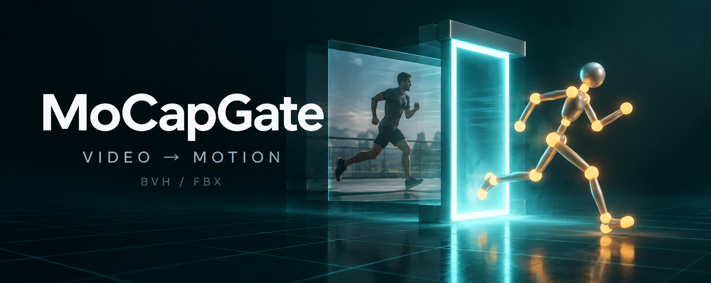
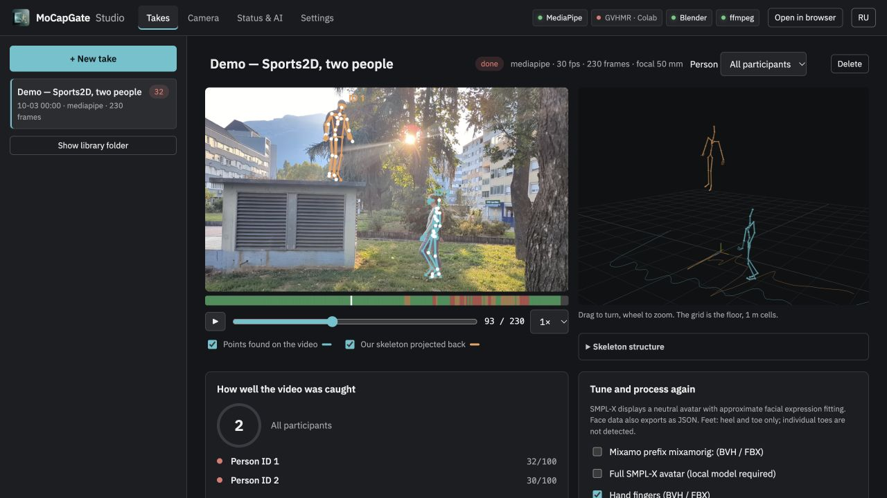
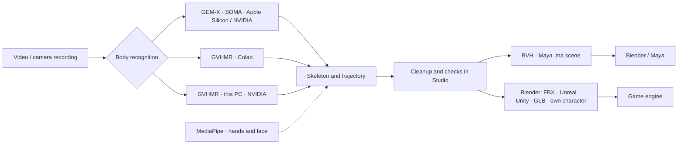
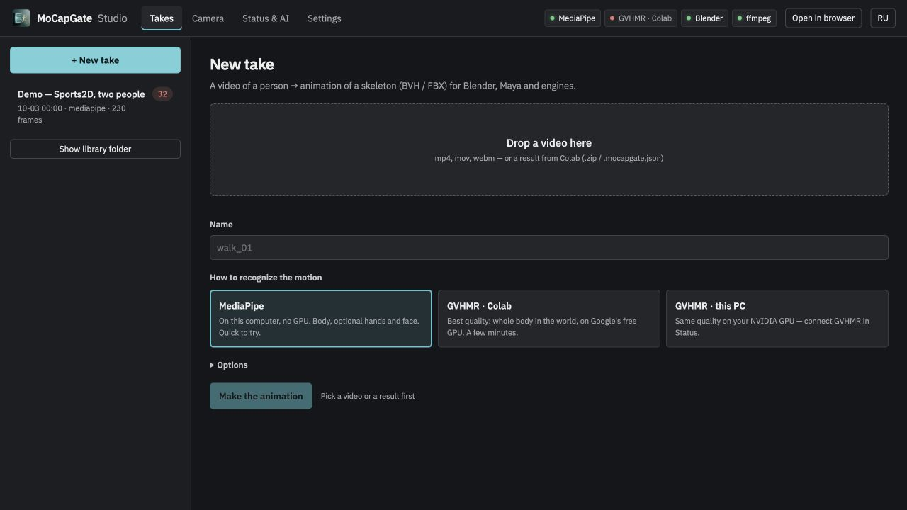
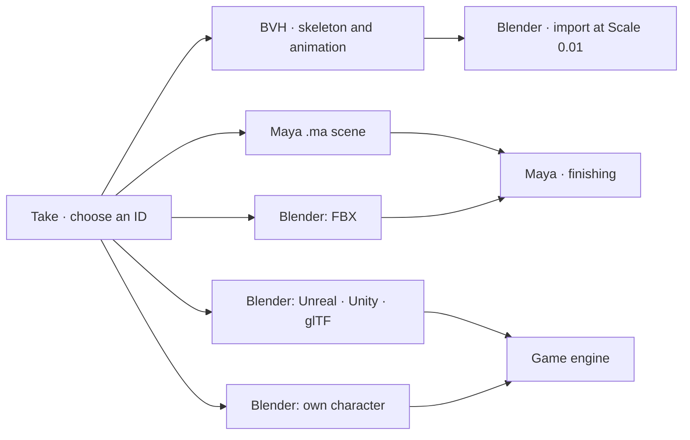

> **Windows x64 · 0.3.3-beta.9.** Public snapshot of the verified native package. Use bundled `python\python.exe` or the Quickstart package. macOS/Linux remain on stable 0.3.2. [Release files](https://github.com/MaverickGH/app-releases/releases/tag/mocapgate-v0.3.3-beta.9).

# MoCapGate

[Русский](README.md) · **English**



**Character animation from an ordinary video.** Film a person with a phone or webcam, recover skeleton motion, check it alongside the original footage, and export it to **Blender, Maya or a game engine**. No motion capture suit is required.

MoCapGate Studio is a local application for **macOS, Windows and Linux**, with Russian and English interfaces. Body motion is recognized by **GEM-X · SOMA** (locally on Apple Silicon, or on NVIDIA through WSL2/Linux) and **GVHMR** (in Google Colab or on your own NVIDIA GPU). It is a tool for animation prototyping and preparation: complex motion still needs inspection and manual cleanup.

[Download stable 0.3.2](https://github.com/MaverickGH/app-releases/releases/tag/mocapgate-v0.3.2) · [All releases, including 0.3.3 beta](https://github.com/MaverickGH/app-releases/releases) · [Report an issue](https://github.com/MaverickGH/mocapgate/issues) · [Apache-2.0](LICENSE)

> **Versions.** The stable release is **0.3.2**. Windows beta **0.3.3-beta.9** is being prepared. This README describes the 0.3.3 beta interface: GEM-X, the setup wizard, engine export, your own character, 52-curve facial expressions and the processing queue arrived in 0.3.3 beta; stable 0.3.2 lacks them and has the previous interface.

[Features](#features) · [Installation](#installation) · [First take](#your-first-take) · [Camera](#recording-with-a-camera) · [Settings](#settings-and-cleanup) · [Models](#recognition-models) · [Export](#export-to-blender-maya-and-engines) · [CLI](#command-line) · [Privacy](#files-and-privacy) · [Troubleshooting](#troubleshooting) · [Documentation](#documentation)

## Features

- **Video → body animation.** GEM-X · SOMA (77 joints: body, fingers, eyes, jaw; experimental) or GVHMR (body and trajectory in world coordinates).
- **Multiple people.** Separate IDs, a shared timeline, simultaneous viewing and individual BVH/FBX/Maya scenes. Detection limit: 1–8, default 4. Group capture is experimental.
- **In-app camera.** Device, resolution and FPS selection, countdown, live framing checks, recording and take creation.
- **Playback and checks.** Original video, detected points, projected skeleton, 3D view, quality strip, Motion review markers and advice on what to film again.
- **Cleanup.** Body and finger jitter smoothing, foot locking, wrist stabilization, fixing a frame range, animation versions.
- **Optional hands and facial expressions.** GVHMR fingers are added to BVH/FBX; expressions export as **52 ARKit curves**: `<take>.face.csv`, a `FaceExpressions` node in the Maya scene, blend shapes on a `FaceExpressions` mesh in FBX/GLB, and a Live Link Face CSV. Raw face and hand points remain in JSON. [Details](docs/facial-expressions.en.md).
- **Export.** BVH and a Maya `.ma` scene directly; FBX, **Unreal · FBX / Unity · FBX / glTF · GLB** and retargeting onto your own character through Blender. Game clips with a seamless loop and a root bone.
- **Library and batch work.** Search, projects, tags and notes; Process as a new take with another model; Select several for export to Unreal / Unity / GLB / FBX; import an existing `.bvh` (Rokoko, Xsens) for cleanup and export without a model.
- **Clip editing and markers.** Mirror, speed, turn, path scale, ease in/out; named frame markers (M key).
- **Neutral SMPL-X avatar.** For GVHMR: body surface, bones or combined viewing; requires your own model.



*0.3.1 interface (to be updated). Prepared Sports2D example; low scores of 32/100 and 30/100 illustrate this capture's limitations. The example demonstrates playback and IDs, not motion accuracy against ground truth.*



## Installation

Native packages: **[MoCapGate 0.3.2](https://github.com/MaverickGH/app-releases/releases/tag/mocapgate-v0.3.2)** (stable). They include CPython 3.12.13 and uv; Studio needs no system Python. Choose the matching OS and architecture.

| Platform | Installer | Portable package |
|---|---|---|
| macOS · Apple Silicon | [dmg](https://github.com/MaverickGH/app-releases/releases/download/mocapgate-v0.3.2/MoCapGate-0.3.2-macos-arm64.dmg) | [ZIP](https://github.com/MaverickGH/app-releases/releases/download/mocapgate-v0.3.2/MoCapGate-0.3.2-macos-arm64-native.zip) |
| macOS · Intel | [dmg](https://github.com/MaverickGH/app-releases/releases/download/mocapgate-v0.3.2/MoCapGate-0.3.2-macos-x64.dmg) | [ZIP](https://github.com/MaverickGH/app-releases/releases/download/mocapgate-v0.3.2/MoCapGate-0.3.2-macos-x64-native.zip) |
| Windows 10/11 · x64 | [exe](https://github.com/MaverickGH/app-releases/releases/download/mocapgate-v0.3.2/MoCapGate-0.3.2-windows-x64-setup.exe) | [ZIP](https://github.com/MaverickGH/app-releases/releases/download/mocapgate-v0.3.2/MoCapGate-0.3.2-windows-x64-native.zip) |
| Linux · x64 | [AppImage](https://github.com/MaverickGH/app-releases/releases/download/mocapgate-v0.3.2/MoCapGate-0.3.2-linux-x64.AppImage) | [ZIP](https://github.com/MaverickGH/app-releases/releases/download/mocapgate-v0.3.2/MoCapGate-0.3.2-linux-x64-native.zip) |

On macOS copy the app from the DMG into Applications; on Windows run the EXE. Linux also has DEB and AppImage packages. Portable ZIPs use `START.sh` (macOS/Linux) or `START_WINDOWS.cmd`. Do not mix architectures. Checksums are in `SHA256SUMS.txt`. 0.3.3 beta prereleases (Windows) are on the [releases page](https://github.com/MaverickGH/app-releases/releases).

**Models are installed separately:** Studio → **Models & tools → Installation, step by step → Check the computer → Install everything recommended**. The check chooses models that suit the computer; installation adds only missing parts and resumes interrupted downloads. Initial downloads need internet access and disk space (GEM-X ~14 GB on Apple Silicon, ~30 GB on Windows/WSL; GVHMR ~15 GB). No SMPL-X model is included. [Setup wizard](docs/setup-wizard.en.md) · [Detailed installation](docs/install.en.md).

The public Git contains loaders, libraries for four platforms and integration source. Originals of eight selected modules are kept separately. Running a clone requires matching Python 3.12.13; ready-made packages are the easiest way to use Studio.

Builds are currently unsigned. macOS may require allowing the app in Privacy & Security; Windows may display SmartScreen. Details: [docs/install.en.md](docs/install.en.md).

In the CLI examples below, `python3` means matching Python 3.12.13. Native ZIPs use `python/bin/python3.12` (macOS/Linux) or `python\python.exe` (Windows).

## Run a public clone

```bash
git clone --branch release/0.3.3-beta.9 https://github.com/MaverickGH/mocapgate.git
cd mocapgate
python3.12 mocapgate.py studio
```

Studio opens in the browser on `127.0.0.1` with a random port and a session token. On Windows, use `python` instead of `python3` in these examples. Dependency setup from a clone is available through `scripts/start_windows.cmd` and `scripts/start_macos.command`.

To download web libraries for subsequent offline viewing, run `python3 scripts/vendor_web.py`. Distributed packages already include them; a source checkout without `vendor/` loads those libraries from a CDN.

## Your first take

1. Open **Models & tools**, click **Check the computer**, then **Install everything recommended**. Without NVIDIA, use **GVHMR · Colab** (any OS); Apple Silicon Macs can also run GEM-X locally.
2. Record a short clip: a stationary camera, even light and the whole body from head to feet. Start with one person and a simple movement.
3. Under **Takes → + Import video**, drop a video or click the upload area to select it. MP4/H.264 is a useful starting point.
4. Under **How to recognize the motion**, choose **GEM-X · SOMA**, **GVHMR · Colab** or **GVHMR · this PC**. For one person, set **Maximum people = 1**.
5. Click **Make the animation**. The take joins the processing queue and starts automatically; time depends on clip length, people, model and hardware. A Colab take waits for the notebook result — see [GVHMR in Colab](#gvhmr-in-colab).
6. Play the take. Compare the points and skeleton against the video; inspect feet, hands, orientation and trajectory in 3D. Read the advice below the viewer.
7. Adjust settings if needed, then click **Process again**. Download BVH or the Maya scene, or create FBX.



*0.3.1 interface (to be updated).*

**Try it without your own video or a body model.** Click **Open the demo take** in Models & tools, or from the clone or portable package root:

```bash
python3 scripts/install_example.py .
python3 mocapgate.py studio
```

This adds **Demo — Sports2D, two people** to your library and preserves an existing copy. Playback needs no model; reprocessing needs an installed model. Source and BSD-3-Clause licensing: [examples/sports2d/README.txt](examples/sports2d/README.txt).

## Recording with a camera

Open **Camera → Turn on the camera**, allow camera access, and choose the device, resolution, FPS and countdown. Enable **Live check: skeleton and hints**, check lighting and framing, press **● Record**, then **■ Stop → Make a take from it**.

The live check (MediaPipe in the browser) helps frame the shot; the saved recording is recognized separately by the selected model. If the desktop window cannot access the camera, use **Open in browser** and check camera permissions there. FFmpeg converts recordings into MP4 with a constant frame rate; the setup wizard installs it.

For full-body capture, place the camera around waist height, leave space around feet and hands, and avoid strong backlight or clothing that hides joints. Stand still for about a second at the beginning and end. Keep people separated when filming a group.

## Settings and cleanup

Take options depend on the selected model.

| Setting | Model | When to change it |
|---|---|---|
| **GEM-X model mode** | GEM-X | **Fast (ONNX)** is the default; **Accurate (PyTorch + foot contacts)** pins feet with GEM-X post-processing; **Maximum (DDIM, 50 steps)** is several times slower |
| **Camera focal length, mm** | GEM-X, GVHMR · this PC | `0` uses the model's estimate; otherwise the 35 mm equivalent (phone main camera ≈ 26) |
| **Person detection confidence / Shortest participant / Remember a lost person** | GEM-X | Lower confidence finds small or partly hidden people (and more false ones); short appearances are ignored; tracker memory in frames (30 ≈ 1 s) |
| **The camera stands still (GVHMR)** | GVHMR · this PC | Enable for tripod footage |
| **GVHMR space** | GVHMR | World (with the path) or Relative to the camera |
| **Smooth body / finger jitter** | all | 0…1: 0 is as recognized; higher removes shaking while fast moves stay sharp (adaptive filter) |
| **Stabilize wrists and fingers** | all | Limits hand rotation outliers; on by default |
| **Pin the feet to the floor** | all | GEM-X: foot contacts + leg IK, with sliding reported before → after; GVHMR: root correction (re-pinned with IK when body smoothing is on) |
| **Root motion** | all | Move as in the video, or In place for loops and characters moved by game code |
| **Export frame rate** | all | Same as source video, 30, 60 or 120; adds no new observations ([details](docs/video-fps.en.md)) |
| **Maximum people** | GEM-X, GVHMR · this PC | Limits simultaneous detections; it does not select the participant to export |
| **Hand fingers / Full face and expressions** | GVHMR; expressions also GEM-X | Enable when details are large and visible; needs the source video and MediaPipe |
| **Mixamo prefix** | all | Adds `mixamorig:` to BVH/FBX bone names; does not retarget onto your character automatically |

Smoothing, root motion and export FPS reuse saved recognition results; changing the model or people limit requires new recognition. Take options and application defaults are separate: changing **Settings** does not replace options in an existing take.

Older MediaPipe takes still open; their options (MediaPipe model, Smoothing, the upper-body mode for desk recordings) belong to the legacy path and are not offered for new takes.

**Reading the checks:** the 0–100 score is a heuristic for visibility, gaps, jitter, sliding and agreement with the image. It is not an accuracy percentage against professional motion capture. The quality strip helps locate problematic sections; select an individual ID for a detailed group-capture report.

**Ranges, fixes and versions.** Select In–Out frames to export a clip (seamless loop, root bone) or to **Fix these frames** with smooth interpolation. The result is saved to **Previous animation versions** before reprocessing and fixing. [Clips and fixes](docs/clips-and-fixes.en.md).

**Queue and comparison.** New takes run one at a time and start the queue themselves; after restarting Studio, resume interrupted takes with **Start queue**. Compare recognition queues a take with another model and plays both skeletons in sync. [Animator workflow](docs/animator-workflow.en.md).

### Multiple people

**All participants** shows the skeletons together; an individual **ID** selects the report, download and Blender/Maya actions. **Make FBX** exports every participant; download the desired ID afterwards. Group files use a `_person_<ID>` suffix and share the same FPS and timeline length. Engine export has an **All participants in one file** option.

After a long disappearance, a person may receive a new ID; occlusion can swap IDs. Depth and relative positions are approximate. A limit of 8 does not guarantee reliable capture of eight people in a crowd. [Details](docs/multiple-people.en.md) · [Real-video checks](docs/multiple-people-real-test.md) (Russian).

### Hands, face and body surface

GEM-X already has fingers, eyes and jaw in the SOMA skeleton. For GVHMR, **Hand fingers (BVH / FBX)** provides 21 observed points per hand and 30 finger bones. **Full face and expressions** (GVHMR and GEM-X) finds the face with the MediaPipe helper tracker and exports 52 ARKit curves: `<take>.face.csv`, a `FaceExpressions` node in the `.ma`, blend shapes on a `FaceExpressions` mesh in FBX/GLB, and a Live Link Face CSV. Raw observations (478 face points, hand points, gaps) remain in **Hands / face data (JSON)**. Small or occluded details are skipped; individual toes are not tracked. [Facial expressions and hands](docs/facial-expressions.en.md).

**Full SMPL-X avatar** (GVHMR) shows a neutral avatar: clothing and appearance are not reconstructed, and expression fitting is approximate. Obtain your own `SMPLX_NEUTRAL.npz` from the [model authors](https://smpl-x.is.tue.mpg.de) and upload it (or the ZIP from the site) in the **SMPL-X body model** card — Studio installs the CPU torch/smplx tools itself. The 3D viewer offers **Capture body**, **Bones** and **Body + bones**. The surface is not exported to BVH/FBX.

## Recognition models

| Option | Where it runs | Requirements | Where the video goes |
|---|---|---|---|
| **GEM-X · SOMA** | Apple Silicon locally (ONNX/CoreML), or NVIDIA through WSL2 (Windows) / Linux | ~14 GB (Mac) or ~30 GB (Windows/WSL), 8 GB VRAM on NVIDIA | Stays on your computer |
| **GVHMR · Colab** | Google Colab GPU, any OS | Google account, your own SMPL-X | You upload it to Colab |
| **GVHMR · this PC** | NVIDIA through WSL2 (Windows) or Linux | ~15 GB, your own SMPL-X; does not run on RTX 50 | Stays on your computer |

**MediaPipe** is no longer offered as a body model: it is an internal helper for hands and face and for the live camera check. The CLI `--backend mediapipe` path remains for compatibility.

GEM-X is experimental: start with one person and a stationary camera. Results depend on the scene; any model may need manual cleanup. Free Colab GPUs depend on service availability and usage limits. Model licences differ: [models and licences](docs/models-licences.en.md).

### GVHMR in Colab

1. Create a take with **GVHMR · Colab**. The video stays in the local take while it waits for the result.
2. Download the [notebook](colab/MoCapGate_GVHMR.ipynb) with the button in the take or from the repository. In [Google Colab](https://colab.research.google.com), choose **File → Upload notebook**, then a GPU runtime such as T4.
3. Run the cells in order. At step 3 upload your **`SMPLX_NEUTRAL.npz`**, at step 4 **the same video** used for the take.
4. Wait for processing and download `*_mocapgate.zip`.
5. Drop the ZIP into the waiting take. Studio imports, checks and exports it. Colab does not compute hands or expressions: enable those options and click **Process again**.

You can also drop an existing ZIP into a new take. Without source video, the result can play in 3D, but video comparison and detail tracking are unavailable.

### GVHMR and GEM-X on this computer

The setup wizard installs GEM-X and GVHMR itself: on Windows inside WSL2/Ubuntu (installing WSL first and asking for a restart if needed), on Linux in separate environments, and on Apple Silicon GEM-X with ONNX/CoreML. GVHMR needs model-term acceptance and your own SMPL-X. Manual paths are under Settings → Preferences and advanced paths. [GVHMR on this PC](docs/gvhmr-managed.en.md) · [Installation](docs/install.en.md).

## Export to Blender, Maya and engines



### Blender

Download BVH → **File → Import → Motion Capture (.bvh)** → **Scale = 0.01** (BVH is written in centimetres). An animated armature appears. Check FPS, scale and root motion. **Open in Blender** performs the prepared import if Blender is detected. [Details](targets/blender/README.md) (Russian).

### Maya

**Download Maya scene (.ma)**: when **Man_Rig** is the selected rig in Settings, the scene contains the Man_Rig character (geometry, skinning, animation); otherwise it contains the capture skeleton. With expressions enabled, the scene has a `FaceExpressions` node. **Open character in Maya** is available when Maya is detected. **Maya finishing tools (.py)** create an additive correction layer. FBX can also be imported into Maya and retargeted with HumanIK. Running inside Maya itself has not been verified. [Details](targets/maya/README.md) (Russian) · [Maya rigs](docs/maya-rigs.en.md).

### Game engines

The **For game engines** block: **Unreal · FBX**, **Unity · FBX**, **glTF · GLB** and **Live Link Face · CSV**, with root motion and **All participants in one file** options. Blender is required. Unreal bone names follow the UE5 Mannequin (a subset: no `spine_02`/`spine_04`; twist bones where the source has them); retarget to Manny with the IK Retargeter if needed. **Import into Unreal and Unity has not been verified.** [Engine export](docs/engines.en.md) · [Your own character](docs/own-character.en.md) · [Engine workflow](targets/engines/README.md) (Russian).

The related [MeshGate](https://github.com/MaverickGH/meshgate) project helps with meshes and assets; it is not required to use MoCapGate.

## Command line

Run commands from the project root. On Windows, replace `python3` with `python`. Quote paths containing spaces.

```bash
# Inspect the environment and open Studio
python3 mocapgate.py doctor
python3 mocapgate.py studio

# Computer check, as in the wizard (exit code 2 = blocking problems)
python3 mocapgate.py preflight [--json] [--no-network] [--lang ru|en]

# Install components
python3 mocapgate.py setup recommended          # FFmpeg, ffprobe, Blender
python3 mocapgate.py setup gemx
python3 mocapgate.py setup gvhmr --accept-model-terms
python3 mocapgate.py setup wsl                  # Windows: WSL2 and Ubuntu
python3 mocapgate.py setup smplx                # CPU SMPL-X tools
python3 mocapgate.py setup blender | ffmpeg | mediapipe

# Create a take for one person, or choose a suitable group limit
python3 mocapgate.py new clip.mp4 --backend gemx-local --max-people 1
python3 mocapgate.py new duet.mp4 --backend gvhmr-local --max-people 2

# Reprocess a take / create FBX (use the path printed by new)
python3 mocapgate.py process "/path/to/take"
python3 mocapgate.py process "/path/to/take" --fbx

# Convert an existing GVHMR JSON; .pt needs torch, .npz needs numpy
python3 mocapgate.py result.mocapgate.json -o motion.bvh

# Check BVH export without models, video or recognition
python3 mocapgate.py --demo demo.bvh
```

`--backend mediapipe` (and `setup mediapipe`) is the legacy path, kept for compatibility. When importing a multi-person scene, direct GVHMR conversion writes separate `motion_person_<ID>.bvh` files. For group video, use `new` or Studio.

## Files and privacy

Takes default to **`~/Documents/MoCapGate Takes`**. Each take is a folder containing `take.json`, source video, recognition cache and results. Deleting a take in Studio removes it from the computer permanently (after confirmation).

Settings: macOS — `~/Library/Application Support/MoCapGate/settings.json`; Windows — `%APPDATA%\MoCapGate\settings.json`; Linux — `~/.config/mocapgate/settings.json` or `XDG_CONFIG_HOME`. Installation logs are in the `logs` folder next to the settings. Change the takes folder in the app, or use `MOCAPGATE_HOME` and `MOCAPGATE_LIBRARY` for isolated runs.

- Studio listens only on loopback and uses a session token. Local GEM-X/GVHMR do not upload video to the cloud.
- **Update check:** at most once every 6 hours Studio requests the release list from `api.github.com/repos/MaverickGH/app-releases`. No data about you or your takes is sent, but GitHub sees your IP address. Disable it in Settings → Check for new versions.
- **Colab:** the video and SMPL-X are uploaded to your Google Colab session (and to Google Drive if you use it).
- Installing models and tools downloads files from their sources. The **Support report** is saved to Downloads and is never sent automatically; it contains no videos or animations.

Details: [architecture](docs/architecture.md) (Russian), [setup wizard](docs/setup-wizard.en.md).

## Troubleshooting

| Symptom | Check |
|---|---|
| Installation does not proceed | Models & tools → Check the computer: each problem comes with a fix button or command |
| GEM-X / GVHMR will not run | Check system readiness in Models & tools; on Windows, the WSL state ([troubleshooting](docs/troubleshooting.en.md)) |
| Black video / no preview | Check FFmpeg and try MP4/H.264 |
| Camera unavailable | OS/browser permissions, another app using the device; try Open in browser |
| 3D will not load from source | Download local libraries: `python3 scripts/vendor_web.py` |
| Jitter / foot sliding | Lighting, body visibility, jitter smoothing and foot locking; compare with another model |
| No individual download button | Switch All participants to a specific ID |
| FBX / engine export fails | Install Blender and check its path in Settings; BVH and `.ma` do not need Blender |
| IDs swap | Separate people, reduce occlusion and inspect the group report |

When filing an [issue](https://github.com/MaverickGH/mocapgate/issues), include your OS, version, model, steps and error text; you can attach a **Support report**. Desktop logs: macOS — `~/Library/Logs/dev.mocapgate.studio/studio.log`; Windows — `%LOCALAPPDATA%\dev.mocapgate.studio\logs\studio.log`. [Troubleshooting](docs/troubleshooting.en.md).

## Documentation

- [Installation](docs/install.en.md) · [Troubleshooting](docs/troubleshooting.en.md) · [Setup wizard](docs/setup-wizard.en.md)
- [Engine export](docs/engines.en.md) · [Your own character](docs/own-character.en.md) · [Clips and fixes](docs/clips-and-fixes.en.md) · [Facial expressions and hands](docs/facial-expressions.en.md)
- [Maya rigs](docs/maya-rigs.en.md) · [Animator workflow](docs/animator-workflow.en.md) · [Multiple people](docs/multiple-people.en.md)
- [What is verified](docs/verification.en.md) · [Models and licences](docs/models-licences.en.md)

## Development

| Location | Purpose |
|---|---|
| `mocapgate.py`, `core/` | CLI, backends, tracking, retargeting, checks and export |
| `apps/studio/` | Python server, interface without a build step, Tauri shell |
| `colab/`, `tools/` | GVHMR notebook, notebook generator and video checks |
| `scripts/` | Dependency setup, packaging, sample installation and artwork generation |
| `examples/`, `tests/fixtures/` | Licensed sample and regression data |
| `docs/`, `targets/` | Installation, architecture, limitations and DCC import |

```bash
python3 -m unittest discover tests
python3 tools/build_colab.py
# Regeneration should match the committed notebook
git diff --exit-code colab/
```

Desktop builds require Node 20+, stable Rust and platform build tools. Windows needs Visual Studio C++ Build Tools and a Windows SDK; Linux needs WebKitGTK development libraries.

```bash
export MOCAPGATE_NATIVE_PACKAGE="$PWD/dist/native-package"
cd apps/studio/desktop
npm ci
npx tauri build
```

[Build requirements](docs/install.en.md#for-maintainers-building) · [Studio](apps/studio/README.md) · [Architecture](docs/architecture.md) · [Roadmap](docs/roadmap.md) · [Repository audit](docs/repository-audit.md). Studio, architecture, roadmap and audit documents are in Russian.

## Licences and limitations

**MoCapGate code is [Apache-2.0](LICENSE)**. Third-party components, models and their terms are listed in [THIRD_PARTY_NOTICES.md](THIRD_PARTY_NOTICES.md) and [models and licences](docs/models-licences.en.md). Sports2D footage carries its own BSD-3-Clause licence.

GVHMR and the downloaded SMPL-X model have separate terms restricting use to non-commercial activities: [GVHMR](https://github.com/zju3dv/GVHMR/blob/main/LICENSE), [SMPL-X](https://smpl-x.is.tue.mpg.de/modellicense.html). GEM-X and SOMA-X code is Apache-2.0, but the GEM-X and SAM 3D Body weights carry their own terms. This repository's Apache-2.0 licence does not replace those terms. The licensed SMPL-X model is not included in source code or installers.

A single camera cannot guarantee correct depth, person-to-person contact, hidden joint rotation or precise expressions. Inspect the export on your character. What is and is not verified: [verification matrix](docs/verification.en.md).

## Native packaging

Eight modules are distributed as native libraries; packages include CPython
3.12.13. Libraries are selected by OS and architecture. Current code uses Apache-2.0; earlier MIT-covered versions retain their permissions.
[Build, verification and publication guide](docs/code-protection.en.md).

Studio previews the skinned Man_Rig character; with Man_Rig selected, `.ma` includes geometry, skin weights and animation. [Animator workflow and limitations](docs/animator-workflow.en.md).

Apache-2.0 transition: 2026-10-07. Attribution: CYBER Department; see [NOTICE](NOTICE). Earlier MIT permissions remain; the original notice is preserved in [the legacy licence](docs/licenses/MoCapGate-MIT-legacy.txt).
