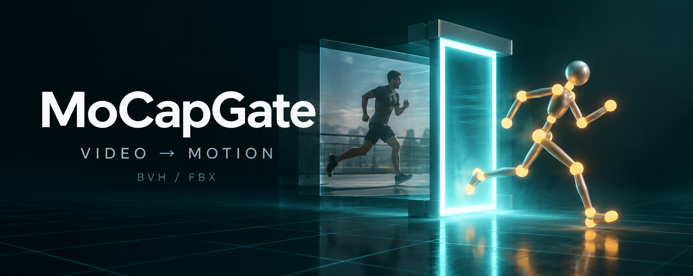
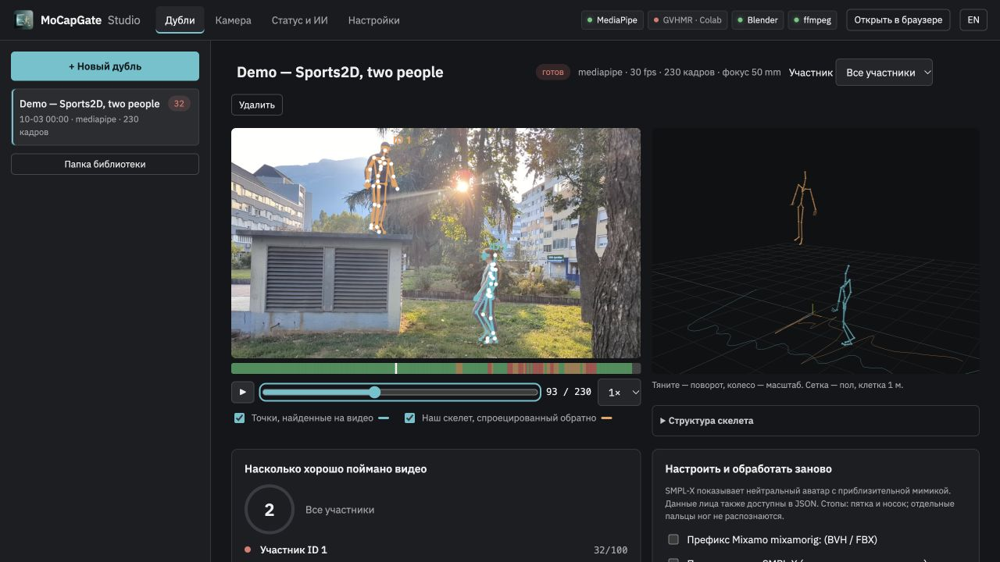
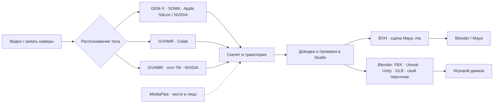
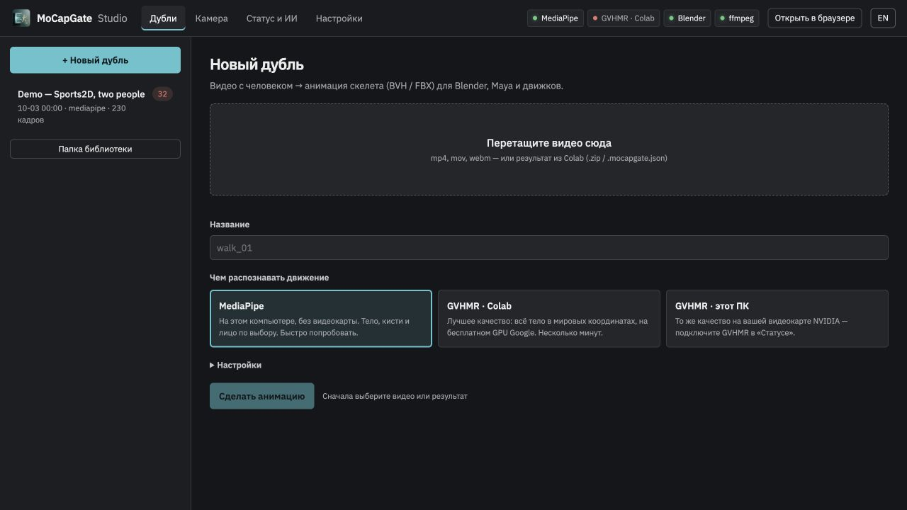
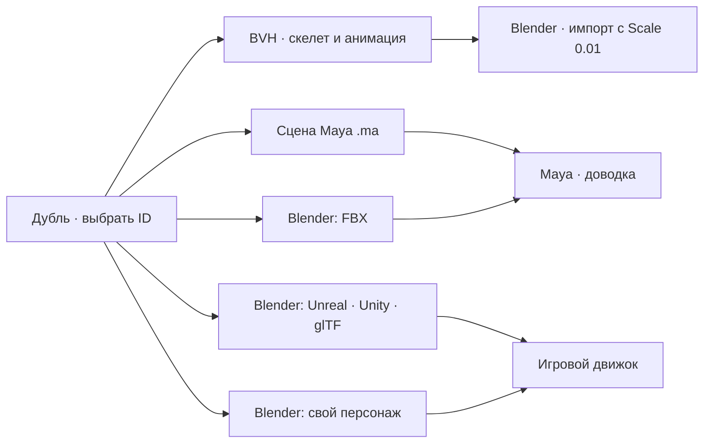

> **Windows x64 · 0.3.3-beta.9.** Это публичный снимок проверенного нативного пакета. Используйте встроенный `python\python.exe` или готовый Quickstart. Для macOS/Linux используйте стабильную 0.3.2. [Файлы релиза](https://github.com/MaverickGH/app-releases/releases/tag/mocapgate-v0.3.3-beta.9).

# MoCapGate

**Русский** · [English](README.en.md)



**Анимация персонажа из обычного видео.** Снимите человека на телефон или веб-камеру, получите движение скелета, проверьте его рядом с исходником и экспортируйте в **Blender, Maya или игровой движок**. Костюм для захвата движения не нужен.

MoCapGate Studio — локальное приложение для **macOS, Windows и Linux** с интерфейсом на русском и английском. Движение тела распознают **GEM-X · SOMA** (локально на Apple Silicon или на NVIDIA через WSL2/Linux) и **GVHMR** (в Google Colab или на своей NVIDIA). Это инструмент для прототипирования и подготовки анимации: сложные движения требуют проверки и ручной доводки.

[Скачать стабильную 0.3.2](https://github.com/MaverickGH/app-releases/releases/tag/mocapgate-v0.3.2) · [Все выпуски, включая 0.3.3 beta](https://github.com/MaverickGH/app-releases/releases) · [Сообщить о проблеме](https://github.com/MaverickGH/mocapgate/issues) · [Apache-2.0](LICENSE)

> **Версии.** Стабильный выпуск — **0.3.2**. Опубликована Windows beta **0.3.3-beta.9**. Этот README описывает интерфейс 0.3.3 beta: GEM-X, мастер установки, экспорт для движков, свой персонаж, мимика 52 кривыми и очередь обработки появились с 0.3.3 beta; в стабильной 0.3.2 их нет, там предыдущий интерфейс.

[Возможности](#возможности) · [Установка](#установка) · [Первый дубль](#первый-дубль) · [Камера](#запись-с-камеры) · [Настройки](#настройки-и-доводка) · [Модели](#модели-распознавания) · [Экспорт](#экспорт-в-blender-maya-и-движки) · [CLI](#командная-строка) · [Приватность](#файлы-и-приватность) · [Проблемы](#если-что-то-не-работает) · [Документация](#документация)

## Возможности

- **Видео → анимация тела.** GEM-X · SOMA (77 суставов: тело, пальцы, глаза, челюсть; экспериментально) или GVHMR (тело и траектория в мировых координатах).
- **Несколько людей.** Отдельные ID, общий таймлайн, совместный просмотр и отдельные BVH/FBX/сцены Maya. Предел обнаружения — 1–8, по умолчанию 4. Групповой режим экспериментальный.
- **Камера в приложении.** Выбор камеры, разрешения и FPS, обратный отсчёт, живая проверка кадра, запись и создание дубля.
- **Просмотр и проверка.** Исходное видео, найденные точки, обратная проекция скелета, 3D, полоса качества, метки «Проверка движения» и советы по пересъёмке.
- **Доводка.** Сглаживание дрожания тела и пальцев, фиксация стоп, стабилизация запястий, исправление участка кадров, версии анимации.
- **Кисти и мимика по выбору.** Пальцы GVHMR добавляются в BVH/FBX; мимика экспортируется **52 кривыми ARKit**: `<дубль>.face.csv`, узел `FaceExpressions` в сцене Maya, blend shapes на меше `FaceExpressions` в FBX/GLB и Live Link Face CSV. Сырые точки лица и кистей остаются в JSON. [Подробнее](docs/facial-expressions.ru.md).
- **Экспорт.** BVH и сцена Maya `.ma` напрямую; FBX, **Unreal · FBX / Unity · FBX / glTF · GLB** и перенос на свой персонаж — через Blender. Фрагменты для игр с бесшовным циклом и корневой костью.
- **Библиотека и пакетная работа.** Поиск, проекты, теги и заметки; «Обработать новым дублем» другой моделью; «Выбрать несколько для экспорта» в Unreal / Unity / GLB / FBX; импорт готового `.bvh` (Rokoko, Xsens) для доводки и экспорта без модели.
- **Правка фрагментов и маркеры.** Зеркало, скорость, поворот, масштаб пути, плавный вход/выход; именованные маркеры кадров (клавиша M).
- **Нейтральный аватар SMPL-X.** Для GVHMR: просмотр поверхности, костей или поверхности с костями; нужна собственная модель.



*Интерфейс 0.3.1 (будет обновлено). Подготовленный пример Sports2D; низкие оценки 32/100 и 30/100 показывают ограничения этого захвата. Пример проверяет воспроизведение и ID, а не эталонную точность движения.*



## Установка

Готовые нативные пакеты: **[MoCapGate 0.3.2](https://github.com/MaverickGH/app-releases/releases/tag/mocapgate-v0.3.2)** (стабильная). Они включают CPython 3.12.13 и uv; устанавливать системный Python для Studio не требуется. Выберите свою ОС и архитектуру.

| Система | Установщик | Без установки |
|---|---|---|
| macOS · Apple Silicon | [dmg](https://github.com/MaverickGH/app-releases/releases/download/mocapgate-v0.3.2/MoCapGate-0.3.2-macos-arm64.dmg) | [ZIP](https://github.com/MaverickGH/app-releases/releases/download/mocapgate-v0.3.2/MoCapGate-0.3.2-macos-arm64-native.zip) |
| macOS · Intel | [dmg](https://github.com/MaverickGH/app-releases/releases/download/mocapgate-v0.3.2/MoCapGate-0.3.2-macos-x64.dmg) | [ZIP](https://github.com/MaverickGH/app-releases/releases/download/mocapgate-v0.3.2/MoCapGate-0.3.2-macos-x64-native.zip) |
| Windows 10/11 · x64 | [exe](https://github.com/MaverickGH/app-releases/releases/download/mocapgate-v0.3.2/MoCapGate-0.3.2-windows-x64-setup.exe) | [ZIP](https://github.com/MaverickGH/app-releases/releases/download/mocapgate-v0.3.2/MoCapGate-0.3.2-windows-x64-native.zip) |
| Linux · x64 | [AppImage](https://github.com/MaverickGH/app-releases/releases/download/mocapgate-v0.3.2/MoCapGate-0.3.2-linux-x64.AppImage) | [ZIP](https://github.com/MaverickGH/app-releases/releases/download/mocapgate-v0.3.2/MoCapGate-0.3.2-linux-x64-native.zip) |

На macOS перенесите приложение из DMG в Applications; на Windows запустите EXE. Для Linux доступны также DEB и AppImage. В переносном ZIP используйте `START.sh` (macOS/Linux) или `START_WINDOWS.cmd`. Не смешивайте пакеты разных архитектур. `SHA256SUMS.txt` содержит контрольные суммы. Предварительные выпуски 0.3.3 beta (Windows) — на [странице выпусков](https://github.com/MaverickGH/app-releases/releases).

**Модели устанавливаются отдельно:** Studio → **«Модели и инструменты» → «Установка шаг за шагом» → «Проверить компьютер» → «Установить всё рекомендуемое»**. Проверка подбирает модели под компьютер, установка ставит только недостающее и продолжает прерванные загрузки. Первое скачивание требует интернета и места на диске (GEM-X ~14 ГБ на Apple Silicon, ~30 ГБ на Windows/WSL; GVHMR ~15 ГБ). Модель SMPL-X не входит в пакеты. [Мастер установки](docs/setup-wizard.ru.md) · [Подробная установка](docs/install.md).

Публичный Git содержит загрузчики, библиотеки четырёх платформ и исходники интеграций. Оригиналы восьми выбранных модулей хранятся отдельно. Для запуска клона нужен Python 3.12.13 подходящей архитектуры; для обычного использования удобнее готовый пакет.

Сборки пока без подписи. macOS может потребовать разрешить открытие приложения в «Конфиденциальность и безопасность», Windows — показать SmartScreen. Подробности: [docs/install.md](docs/install.md).

В CLI-примерах ниже `python3` означает подходящий Python 3.12.13. В нативном ZIP используйте `python/bin/python3.12` (macOS/Linux) или `python\python.exe` (Windows).

## Запуск публичного клона

```bash
git clone --branch release/0.3.3-beta.9 https://github.com/MaverickGH/mocapgate.git
cd mocapgate
python3.12 mocapgate.py studio
```

Studio откроется в браузере на `127.0.0.1` со случайным портом и токеном сессии. На Windows в примерах используйте `python` вместо `python3`. Для подготовки зависимостей из клона доступны `scripts/start_windows.cmd` и `scripts/start_macos.command`.

Чтобы скачать веб-библиотеки для последующего офлайн-просмотра, выполните `python3 scripts/vendor_web.py`. Готовые пакеты уже содержат их; при запуске исходников без `vendor/` интерфейс получает библиотеки с CDN.

## Первый дубль

1. Откройте **«Модели и инструменты»**, нажмите **«Проверить компьютер»**, затем **«Установить всё рекомендуемое»**. Без NVIDIA используйте **GVHMR · Colab** (любая ОС), на Mac с Apple Silicon — ещё и локальный GEM-X.
2. Снимите короткое видео: неподвижная камера, ровный свет, всё тело от головы до стоп. Начните с одного человека и простого движения.
3. В **«Дубли» → «+ Импорт видео»** перетащите видео или выберите его нажатием на область загрузки. Лучше начать с MP4/H.264.
4. В **«Чем распознавать движение»** выберите **GEM-X · SOMA**, **GVHMR · Colab** или **GVHMR · этот ПК**. Для одного человека поставьте **«Максимум людей» = 1**.
5. Нажмите **«Сделать анимацию»**. Дубль встаёт в очередь обработки и запускается сам; время зависит от длительности, числа людей, модели и компьютера. Для Colab дубль ждёт результат ноутбука — см. [GVHMR в Colab](#gvhmr-в-colab).
6. Проиграйте дубль. Сравните точки и скелет с видео, проверьте стопы, руки, направление и траекторию в 3D. Прочитайте советы под просмотром.
7. При необходимости измените настройки и нажмите **«Обработать заново»**. Затем скачайте BVH, сцену Maya или создайте FBX.



*Интерфейс 0.3.1 (будет обновлено).*

**Можно попробовать без своего видео и без модели тела.** В «Модели и инструменты» нажмите **«Открыть демо-дубль»** или из корня клона / переносного пакета:

```bash
python3 scripts/install_example.py .
python3 mocapgate.py studio
```

Команда добавляет готовый дубль **Demo — Sports2D, two people** в библиотеку и не заменяет уже существующий пример. Просмотр работает без моделей; повторная обработка требует установленной модели. Источник и BSD-3-Clause лицензия: [examples/sports2d/README.txt](examples/sports2d/README.txt).

## Запись с камеры

Вкладка **«Камера»** → **«Включить камеру»** → разрешить доступ → выбрать устройство, разрешение, FPS и обратный отсчёт. Включите **«Живая проверка: скелет и подсказки»**, проверьте свет и границы кадра, нажмите **«● Записать»**, затем **«■ Стоп» → «Сделать дубль»**.

Живая проверка (MediaPipe в браузере) помогает поставить кадр; сохранённое видео проходит отдельное распознавание выбранной моделью. Если камера не доступна в десктопном окне, воспользуйтесь **«Открыть в браузере»** и проверьте разрешения камеры там. FFmpeg преобразует запись в MP4 с постоянной частотой кадров; мастер установки ставит его.

Для съёмки всего тела поставьте камеру примерно на высоте пояса, оставьте запас вокруг стоп и кистей, избегайте контрового света и одежды, скрывающей суставы. В начале и конце постойте спокойно около секунды. В группе оставляйте расстояние между людьми.

## Настройки и доводка

Настройки дубля зависят от выбранной модели.

| Настройка | Модель | Когда менять |
|---|---|---|
| **Режим модели GEM-X** | GEM-X | «Быстро (ONNX)» — по умолчанию; «Точно (PyTorch + контакты стоп)» прижимает стопы постобработкой GEM-X; «Максимум (DDIM, 50 шагов)» — в разы дольше |
| **Фокус камеры, мм** | GEM-X, GVHMR · этот ПК | `0` — оценка модели; иначе 35-мм эквивалент (основная камера телефона ≈ 26) |
| **Уверенность обнаружения людей / Минимальная длительность участника / Помнить потерянного человека** | GEM-X | Ниже уверенность — находит мелких и закрытых (и больше ложных); короткие появления отбрасываются; память трекера в кадрах (30 ≈ 1 с) |
| **Камера неподвижна (GVHMR)** | GVHMR · этот ПК | Включайте для съёмки со штатива |
| **Пространство GVHMR** | GVHMR | «Мир (с траекторией)» или «Относительно камеры» |
| **Сгладить дрожание тела / пальцев** | все | 0…1: 0 — как распознано; больше — меньше дрожания, быстрые движения остаются чёткими (адаптивный фильтр) |
| **Стабилизация запястий и пальцев** | все | Ограничивает выбросы поворотов кистей; включена по умолчанию |
| **Фиксировать стопы на полу** | все | GEM-X: контакты стоп + IK ног, в итоге показано скольжение «до → после»; GVHMR: коррекция корня (при сглаживании тела — повторная фиксация IK) |
| **Движение корня** | все | «Перемещаться как на видео» или «На месте» для циклов и движения персонажа кодом |
| **FPS экспорта** | все | «Как у исходного видео», 30, 60 или 120; новых наблюдений движения не добавляет ([подробнее](docs/video-fps.ru.md)) |
| **Максимум людей** | GEM-X, GVHMR · этот ПК | Предел одновременно обнаруживаемых людей, а не выбор экспортируемого участника |
| **Пальцы рук / Полное лицо и мимика** | GVHMR; мимика также GEM-X | Включать, когда детали крупные и видны; нужен исходный видеоряд и MediaPipe |
| **Префикс Mixamo** | все | Добавляет `mixamorig:` к именам BVH/FBX; не переносит движение на ваш риг автоматически |

Сглаживание, корень и FPS экспорта используют сохранённые результаты распознавания; смена модели или предела людей требует нового распознавания. Настройки дубля и общие значения по умолчанию находятся в разных местах: изменение **«Настроек»** не заменяет опции уже созданного дубля.

Старые дубли MediaPipe по-прежнему открываются; их настройки («Модель MediaPipe», «Сглаживание», режим «Только верх тела» при съёмке за столом) относятся к прежнему пути и в новых дублях не предлагаются.

**Как читать проверку:** балл 0–100 — эвристика видимости, пропусков, дрожания, скольжения и совпадения с кадром. Это не процент точности относительно профессионального мокапа. Полоса качества помогает найти проблемные фрагменты; при групповом захвате выберите ID для подробного отчёта.

**Участки, исправления и версии.** Выделите кадры In–Out, чтобы экспортировать фрагмент (бесшовный цикл, корневая кость) или **«Исправить эти кадры»** плавной интерполяцией. Перед повторной обработкой и исправлением результат сохраняется в **«Предыдущие версии анимации»**. [Фрагменты и исправления](docs/clips-and-fixes.ru.md).

**Очередь и сравнение.** Новые дубли обрабатываются по одному и запускают очередь сами; после перезапуска Studio прерванные продолжаются кнопкой **«Запустить очередь»**. «Сравнение распознаваний» ставит в очередь дубль другой моделью и показывает оба скелета синхронно. [Рабочий процесс аниматора](docs/animator-workflow.ru.md).

### Несколько людей

**«Все участники»** показывает скелеты вместе; отдельный **ID** переключает отчёт, скачивание и открытие в Blender/Maya. **«Сделать FBX»** экспортирует всех участников, после чего скачивайте нужный ID. У файлов группы есть суффикс `_person_<ID>`; FPS и длина таймлайна общие. Для движков есть опция **«Все участники одним файлом»**.

После долгого исчезновения человек может получить новый ID, при перекрытиях ID могут перепутаться. Глубина и взаимное положение людей оцениваются приблизительно. Предел 8 не означает надёжного захвата восьми человек в толпе. [Подробности](docs/multiple-people.md) · [Проверки на настоящем видео](docs/multiple-people-real-test.md).

### Кисти, лицо и поверхность

GEM-X уже содержит пальцы, глаза и челюсть в скелете SOMA. Для GVHMR **«Пальцы рук (BVH / FBX)»** дают 21 наблюдаемую точку на руку и 30 костей пальцев. **«Полное лицо и мимика»** (GVHMR и GEM-X) находит лицо вспомогательным трекером MediaPipe и экспортирует 52 кривые ARKit: `<дубль>.face.csv`, узел `FaceExpressions` в `.ma`, blend shapes на меше `FaceExpressions` в FBX/GLB, Live Link Face CSV. Сырые наблюдения (478 точек лица, точки кистей, пропуски) остаются в **«Кисти / лицо (JSON)»**. Маленькие или перекрытые детали пропускаются; отдельные пальцы ног не распознаются. [Мимика и кисти](docs/facial-expressions.ru.md).

**«Полная модель SMPL-X»** (GVHMR) показывает нейтральный аватар: одежда и внешность не восстанавливаются, мимика подгоняется приблизительно. Нужна собственная `SMPLX_NEUTRAL.npz` от [авторов модели](https://smpl-x.is.tue.mpg.de): загрузите её (или ZIP с сайта) в карточке **«Модель тела SMPL-X»** — программа сама поставит CPU-инструменты torch/smplx. В 3D появятся режимы **«Тело распознавания»**, **«Кости»**, **«Тело + кости»**. Поверхность в BVH/FBX не экспортируется.

## Модели распознавания

| Вариант | Где работает | Что требуется | Где остаётся видео |
|---|---|---|---|
| **GEM-X · SOMA** | Apple Silicon локально (ONNX/CoreML) или NVIDIA через WSL2 (Windows) / Linux | ~14 ГБ (Mac) или ~30 ГБ (Windows/WSL), 8 ГБ видеопамяти на NVIDIA | На вашем компьютере |
| **GVHMR · Colab** | GPU Google Colab, любая ОС | Аккаунт Google, своя SMPL-X | Загружается вами в Colab |
| **GVHMR · этот ПК** | NVIDIA через WSL2 (Windows) или Linux | ~15 ГБ, своя SMPL-X; не работает на RTX 50 | На вашем компьютере |

**MediaPipe** больше не предлагается как модель тела: это внутренний помощник для кистей и лица и для живой проверки камеры. Путь `--backend mediapipe` в CLI оставлен для совместимости.

GEM-X экспериментальный: начните с одного человека и неподвижной камеры. Результаты зависят от сцены; ошибки и ручная доводка возможны с любой моделью. Бесплатный GPU Colab зависит от доступности и лимитов сервиса. Лицензии моделей различаются: [модели и лицензии](docs/models-licences.ru.md).

### GVHMR в Colab

1. Создайте дубль с **GVHMR · Colab**. Видео останется в локальном дубле, который будет ждать результат.
2. Скачайте [ноутбук](colab/MoCapGate_GVHMR.ipynb) кнопкой в дубле или из репозитория. В [Google Colab](https://colab.research.google.com) выберите **«Файл → Загрузить блокнот»**, затем среду с GPU (например, T4).
3. Выполняйте ячейки по порядку. На шаге 3 загрузите свою **`SMPLX_NEUTRAL.npz`**, на шаге 4 — **то же видео**, что выбрали для дубля.
4. Дождитесь расчёта и скачайте `*_mocapgate.zip`.
5. Перетащите ZIP в ожидающий дубль. Studio выполнит импорт, проверку и экспорт. Кисти и мимику Colab не считает: включите опции и нажмите **«Обработать заново»**.

Существующий ZIP можно также перетащить в новый дубль. Без исходного видео доступен 3D-просмотр результата, но нет сравнения с видеорядом и распознавания деталей.

### GVHMR и GEM-X на этом компьютере

Мастер установки ставит GEM-X и GVHMR сам: на Windows — внутри WSL2/Ubuntu (при необходимости сначала ставит WSL и просит перезагрузку), на Linux — в отдельные окружения, на Apple Silicon — GEM-X с ONNX/CoreML. Для GVHMR нужно принять условия моделей и загрузить свою SMPL-X. Ручные пути — в «Настройки» → «Предпочтения и дополнительные пути». [GVHMR на этом ПК](docs/gvhmr-managed.ru.md) · [Установка](docs/install.md).

## Экспорт в Blender, Maya и движки



### Blender

Скачайте BVH → **File → Import → Motion Capture (.bvh)** → **Scale = 0.01** (BVH записан в сантиметрах). Появится арматура с анимацией. Проверьте FPS, масштаб и движение корня. Кнопка **«Открыть в Blender»** выполняет подготовленный импорт, если Blender найден. [Подробнее](targets/blender/README.md).

### Maya

**«Скачать сцену Maya (.ma)»**: если в «Настройках» выбран риг **Man_Rig**, сцена содержит персонажа Man_Rig (геометрия, скиннинг, анимация); иначе — скелет захвата. При включённой мимике в сцене есть узел `FaceExpressions`. **«Открыть персонажа в Maya»** доступно, если Maya найдена. **«Инструменты правок Maya (.py)»** создают аддитивный слой поправок. FBX можно импортировать в Maya и перенести через HumanIK. Работа в самой Maya не проверялась. [Подробнее](targets/maya/README.md) · [Риги Maya](docs/maya-rigs.ru.md).

### Игровые движки

Блок **«Для игровых движков»**: **Unreal · FBX**, **Unity · FBX**, **glTF · GLB** и **Live Link Face · CSV**; опции root motion и **«Все участники одним файлом»**. Нужен Blender. Имена костей Unreal следуют UE5 Mannequin (подмножество: без `spine_02`/`spine_04`; twist-кости — где есть в источнике); для Manny при необходимости используйте IK Retargeter. **Импорт в Unreal и Unity не проверялся.** [Экспорт для движков](docs/engines.ru.md) · [Свой персонаж](docs/own-character.ru.md) · [Путь в движки](targets/engines/README.md).

Связанный проект [MeshGate](https://github.com/MaverickGH/meshgate) помогает работать с мешами и ассетами; для использования MoCapGate он не требуется.

## Командная строка

Команды запускаются из корня проекта. В Windows замените `python3` на `python`. Для путей с пробелами используйте кавычки.

```bash
# Проверить окружение и открыть Studio
python3 mocapgate.py doctor
python3 mocapgate.py studio

# Проверка компьютера, как в мастере (код выхода 2 — есть блокирующие проблемы)
python3 mocapgate.py preflight [--json] [--no-network] [--lang ru|en]

# Установка компонентов
python3 mocapgate.py setup recommended          # FFmpeg, ffprobe, Blender
python3 mocapgate.py setup gemx
python3 mocapgate.py setup gvhmr --accept-model-terms
python3 mocapgate.py setup wsl                  # Windows: WSL2 и Ubuntu
python3 mocapgate.py setup smplx                # CPU-инструменты SMPL-X
python3 mocapgate.py setup blender | ffmpeg | mediapipe

# Создать дубль одного человека; для группы поставьте подходящий предел
python3 mocapgate.py new clip.mp4 --backend gemx-local --max-people 1
python3 mocapgate.py new duet.mp4 --backend gvhmr-local --max-people 2

# Переобработать дубль / создать FBX (подставьте путь, выведенный new)
python3 mocapgate.py process "/path/to/take"
python3 mocapgate.py process "/path/to/take" --fbx

# Конвертировать уже рассчитанный GVHMR JSON; .pt требует torch, .npz — numpy
python3 mocapgate.py result.mocapgate.json -o motion.bvh

# Проверить BVH-экспорт без моделей, видео и распознавания
python3 mocapgate.py --demo demo.bvh
```

`--backend mediapipe` (и `setup mediapipe`) — прежний путь, оставлен для совместимости. При импорте сцены с несколькими людьми прямой режим GVHMR записывает отдельные `motion_person_<ID>.bvh`. Для видео с группой используйте `new` или Studio.

## Файлы и приватность

Дубли по умолчанию сохраняются в **`~/Documents/MoCapGate Takes`**. Каждый дубль — папка с `take.json`, исходным видео, кэшем распознавания и результатами. Удаление дубля в Studio удаляет его с компьютера насовсем (после подтверждения).

Настройки: macOS — `~/Library/Application Support/MoCapGate/settings.json`, Windows — `%APPDATA%\MoCapGate\settings.json`, Linux — `~/.config/mocapgate/settings.json` (или `XDG_CONFIG_HOME`). Журналы установки — в папке `logs` рядом с настройками. Папку дублей можно изменить в приложении; для изолированного запуска есть `MOCAPGATE_HOME` и `MOCAPGATE_LIBRARY`.

- Сервер Studio слушает только loopback и использует токен сессии. Локальные GEM-X/GVHMR не отправляют видео в облако.
- **Проверка обновлений:** не чаще раза в 6 часов Studio запрашивает список выпусков `api.github.com/repos/MaverickGH/app-releases`. Данные о вас и дублях не передаются, но GitHub видит ваш IP-адрес. Отключается в «Настройки» → «Проверять новые версии».
- **Colab:** видео и SMPL-X загружаются в вашу сессию Google Colab (и в Google Drive, если вы им пользуетесь).
- Установка моделей и инструментов скачивает файлы из их источников. **«Отчёт для поддержки»** сохраняется в «Загрузки» и никуда не отправляется сам; видео и анимаций в нём нет.

Подробности: [архитектура](docs/architecture.md), [мастер установки](docs/setup-wizard.ru.md).

## Если что-то не работает

| Симптом | Что проверить |
|---|---|
| Установка не идёт | «Модели и инструменты» → «Проверить компьютер»: у каждой проблемы есть кнопка или команда исправления |
| GEM-X / GVHMR не запускается | «Проверить готовность системы» в «Модели и инструменты»; на Windows — состояние WSL ([решение проблем](docs/troubleshooting.ru.md)) |
| Чёрное видео / нет предпросмотра | Проверить FFmpeg, попробовать MP4/H.264 |
| Камера недоступна | Разрешения ОС и браузера, другое приложение с камерой; попробовать «Открыть в браузере» |
| 3D не загружается из исходников | Скачать локальные библиотеки: `python3 scripts/vendor_web.py` |
| Кости дрожат / стопы скользят | Свет, видимость тела, «Сгладить дрожание», фиксация стоп; сравнить с другой моделью |
| Нет кнопки скачивания выбранного человека | Переключить «Все участники» на конкретный ID |
| FBX / движки не создаются | Установить Blender, проверить его путь в «Настройках»; BVH и `.ma` доступны без Blender |
| ID путаются | Разнести людей в кадре, уменьшить перекрытия, проверить групповой отчёт |

В [issue](https://github.com/MaverickGH/mocapgate/issues) укажите ОС, версию, модель, шаги и текст ошибки; можно приложить **«Отчёт для поддержки»**. Десктопный лог: macOS — `~/Library/Logs/dev.mocapgate.studio/studio.log`, Windows — `%LOCALAPPDATA%\dev.mocapgate.studio\logs\studio.log`. [Решение проблем](docs/troubleshooting.ru.md).

## Документация

- [Установка](docs/install.md) · [Решение проблем](docs/troubleshooting.ru.md) · [Мастер установки](docs/setup-wizard.ru.md)
- [Экспорт для движков](docs/engines.ru.md) · [Свой персонаж](docs/own-character.ru.md) · [Фрагменты и исправления](docs/clips-and-fixes.ru.md) · [Мимика и кисти](docs/facial-expressions.ru.md)
- [Риги Maya](docs/maya-rigs.ru.md) · [Рабочий процесс аниматора](docs/animator-workflow.ru.md) · [Несколько людей](docs/multiple-people.md)
- [Что проверено](docs/verification.md) · [Модели и лицензии](docs/models-licences.ru.md)

## Разработка

| Папка | Назначение |
|---|---|
| `mocapgate.py`, `core/` | CLI, бэкенды, трекинг, ретаргет, проверка и экспорт |
| `apps/studio/` | Python-сервер, интерфейс без сборки, оболочка Tauri |
| `colab/`, `tools/` | Ноутбук GVHMR, его генератор и проверки видео |
| `scripts/` | Подготовка зависимостей, упаковка, готовый пример и создание графики |
| `examples/`, `tests/fixtures/` | Лицензированный пример и данные регрессий |
| `docs/`, `targets/` | Установка, архитектура, ограничения и импорт в DCC |

```bash
python3 -m unittest discover tests
python3 tools/build_colab.py
# После генерации не должно быть неожиданного расхождения с сохранённым ноутбуком
git diff --exit-code colab/
```

Сборка десктопа требует Node 20+, Rust stable и платформенных инструментов:

```bash
export MOCAPGATE_NATIVE_PACKAGE="$PWD/dist/native-package"
cd apps/studio/desktop
npm ci
npx tauri build
```

[Требования сборки](docs/install.md#для-сопровождающих-сборка) · [Studio](apps/studio/README.md) · [Архитектура](docs/architecture.md) · [Роадмап](docs/roadmap.md) · [Аудит репозитория](docs/repository-audit.md).

## Лицензии и ограничения

**Код MoCapGate — [Apache-2.0](LICENSE)**. Сторонние компоненты, модели и их условия перечислены в [THIRD_PARTY_NOTICES.md](THIRD_PARTY_NOTICES.md) и [моделях и лицензиях](docs/models-licences.ru.md). Видео Sports2D распространяется со своей BSD-3-Clause лицензией.

GVHMR и скачиваемая модель SMPL-X имеют отдельные условия с ограничениями коммерческого использования: [GVHMR](https://github.com/zju3dv/GVHMR/blob/main/LICENSE), [SMPL-X](https://smpl-x.is.tue.mpg.de/modellicense.html). Код GEM-X и SOMA-X — Apache-2.0, но веса моделей GEM-X и SAM 3D Body имеют собственные условия. Apache-2.0 лицензия этого репозитория не заменяет эти условия. Лицензированная модель SMPL-X не включена в исходники и установщики.

Одна камера не гарантирует правильную глубину, контакты людей, поворот скрытых суставов или точную мимику. Проверяйте экспорт на своём персонаже. Что проверено и что нет: [матрица проверок](docs/verification.md).

## Нативная упаковка

Восемь модулей поставляются нативными библиотеками; пакеты включают CPython
3.12.13. Библиотеки выбираются по ОС и архитектуре. Текущий код — Apache-2.0; ранее опубликованные MIT-версии сохраняют свои права.
[Сборка, проверка и безопасная публикация](docs/code-protection.ru.md).

Персонаж Man_Rig доступен прямо в Studio; при выбранном Man_Rig `.ma` содержит геометрию, скиннинг и анимацию. [Рабочий процесс аниматора и ограничения](docs/animator-workflow.ru.md).

Переход на Apache-2.0: 2026-10-07. Авторство — CYBER Department; см. [NOTICE](NOTICE). Ранее выданные права MIT сохраняются; оригинальный текст сохранён в [архиве лицензии](docs/licenses/MoCapGate-MIT-legacy.txt).
