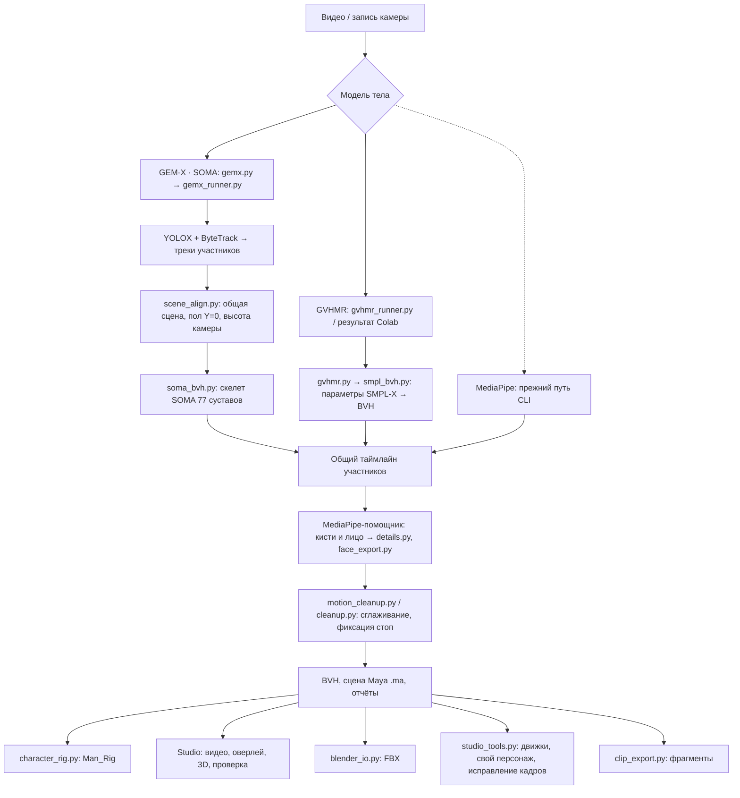
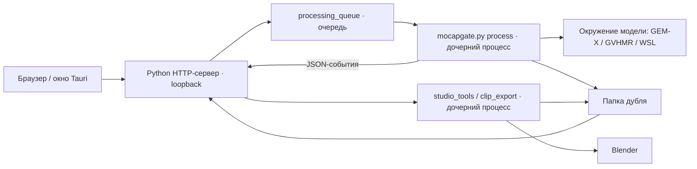

# Архитектура MoCapGate

Актуальная схема для 0.3.3 beta (стабильная 0.3.2 — предыдущий интерфейс, где MediaPipe был моделью тела). Пользовательские инструкции: [русский README](../README.md) · [English README](../README.en.md).

## От видео до анимации

- **GEM-X:** `core/gemx.py` управляет окружением (локально или в WSL) и запускает `core/gemx_runner.py` в нём. Один проход YOLOX+ByteTrack выделяет устойчивые треки (по умолчанию не короче 0,25 с), для каждого — 2D-точки, признаки SAM 3D Body и GEM-X. На Apple Silicon ONNX работает через CoreML с откатом на CPU. `core/scene_align.py` ставит участников в одну сцену по гравитации, пол Y=0 по стопам. `core/soma_bvh.py` пишет настоящий скелет SOMA.
- **GVHMR:** `core/gvhmr_runner.py` запускает отдельное окружение NVIDIA (WSL2 на Windows). `core/gvhmr.py` читает `.pt`, `.npz`, JSON и сцены с несколькими людьми. В Colab применяется тот же адаптер и BVH-конвертер; ноутбук генерируется `tools/build_colab.py`. Внешний GVHMR и веса не входят в репозиторий.
- **MediaPipe:** внутренний помощник. `core/details.py` и `detail_worker.py` находят кисти и лицо на исходном видео; `hand_bvh.py` добавляет пальцы GVHMR; `face_export.py` пишет 52 кривые ARKit (CSV, узел `FaceExpressions` в `.ma`), `livelink.py` — Live Link Face CSV. Прежний бэкенд тела (`pose_worker.py`, `person_detector.py`, `person_tracking.py`, `retarget.py`) доступен через CLI `--backend mediapipe` и для старых дублей.
- **Чистка:** `motion_cleanup.py` — сглаживание One Euro по кватернионам (0…1, тело и пальцы отдельно) и фиксация стоп по контактам с аналитическим IK ног (отчёт о скольжении до/после); `cleanup.py` — коррекция корня для параметров SMPL; `hand_stability.py` — стабилизация запястий.
- **Выход:** `smpl_bvh.py` и `soma_bvh.py` пишут BVH, `mixamo.py` задаёт имена, `maya_export.py` — прямую сцену `.ma`, `character_rig.py` переносит движение на Man_Rig без выполнения сцены. `blender_io.py` делает FBX; `blender_export.py` (пресеты Unreal / Unity / glTF), `engine_export.py` и `bone_map.py` (UE5 Mannequin, Mixamo, Rigify, CC, Daz, VRoid) работают внутри Blender. `blender_retarget.py` переносит движение на свой персонаж. `anim_tools.py` — бесшовный цикл и корневая кость, `clip_export.py` — фрагменты, `take_history.py` — версии в `versions/`.
- **Поверхность:** отдельный `mesh_worker.py` с torch/smplx создаёт данные нейтрального аватара SMPL-X. `expressive.py` и `face_fit.py` подгоняют детали приблизительно. Поверхность не экспортируется кнопками BVH/FBX.

## Установка и сервисные модули

- `preflight.py` — проверка компьютера (ОС, память, диск, папка дублей, прокси, сеть, GPU и драйвер, WSL, инструменты Mac) и рекомендация моделей; `.wslconfig` пишет только по явному согласию.
- `install_util.py` — возобновляемые загрузки с проверкой размера и SHA-256, venv, git clone; `install_help.py` — разбор текста ошибок в конкретные советы.
- `managed_tools.py` — FFmpeg, ffprobe, Blender, CPU-инструменты SMPL-X; `components.py` — состояние компонентов; `scripts/setup_gemx.py`, `scripts/setup_gvhmr.py` — закреплённые ревизии моделей.
- `processing_queue.py` — сохраняемая последовательная очередь; прерванные задачи требуют явного возобновления.
- `updates.py` — анонимная проверка выпусков на GitHub с кэшем 6 часов.
- `workbench.py` — метки проверки движения и профили ригов Maya.

## Studio и процессы

Сервер `apps/studio/server.py` работает на стандартной библиотеке. Интерфейс `ui/` не требует сборки: `studio.js` содержит логику и RU/EN, `workbench.js` — проверку движения, сравнение, очередь и профили, `viewer3d.js` использует three.js. Tauri-оболочка находит Python, запускает сервер и открывает его адрес; вычислительное ядро остаётся Python. Конечные точки: [apps/studio/README.md](../apps/studio/README.md#api).

Долгие задачи выполняются дочерними процессами; Studio читает JSON-события и позволяет отменить обработку. GEM-X, GVHMR, MediaPipe и torch/smplx используют собственные окружения, поэтому их зависимости не нужны для запуска ядра, демо и просмотра готовых BVH.

## Дубль и кэш

`core/pipeline.py` создаёт папку в библиотеке. `take.json` содержит ID, бэкенд, опции и ссылки на результат каждого участника. Видео копируется в дубль; для GEM-X/GVHMR оно приводится к 30 FPS через FFmpeg. Смена модели или предела людей вызывает новое распознавание; сглаживание, фиксация стоп, корень и FPS экспорта переиспользуют кэш. Перед повторной обработкой готовый результат архивируется в `versions/`.

Групповые результаты имеют общий FPS и длину; вне наблюдаемого интервала экспорт удерживает позу, а просмотр скрывает участника. Имена файлов и покрытие деталей нужно читать из метаданных, а не предполагать один фиксированный набор.

## Локальный доступ и сеть

Сервер слушает `127.0.0.1`, проверяет Host на loopback, требует токен сессии для API, принимает изменяющие POST-запросы как JSON. Внешние ссылки ограничены списком допустимых адресов. Удаление дубля удаляет его папку после подтверждения.

Локальная обработка не загружает видео в облако. При установке скачиваются инструменты, библиотеки и модели. Проверка обновлений раз в 6 часов запрашивает список выпусков `api.github.com/repos/MaverickGH/app-releases` без данных пользователя (GitHub видит IP); отключается в настройках. `scripts/vendor_web.py` сохраняет three.js и MediaPipe Tasks Vision для офлайн-работы; без этих файлов сервер перенаправляет запросы библиотек на CDN. Пользователь сам загружает видео и SMPL-X в Google Colab, если выбирает этот путь.

## Границы системы

С одной камеры глубина и перекрытые суставы неоднозначны. Общая сцена группы не гарантирует точные контакты или взаимные мировые позиции. Совпадение имён с Mixamo или UE5 Mannequin помогает сопоставлению, но не гарантирует корректного ретаргета на любой риг. Что проверено: [матрица проверок](verification.md). MeshGate — необязательный соседний инструмент, не зависимость MoCapGate.
