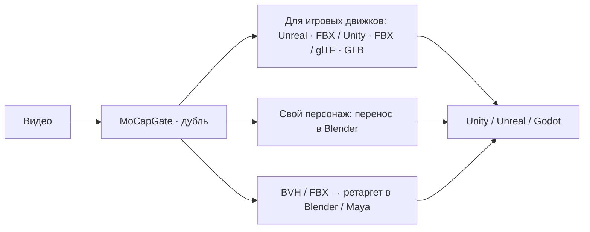

# Анимация MoCapGate в игровых движках

MoCapGate выдаёт анимацию скелета, которую нужно согласовать с персонажем проекта. MeshGate для этого не обязателен.
Описание соответствует 0.3.3 beta; в стабильной 0.3.2 блока «Для игровых движков» нет. *English: [engine export](../../docs/engines.en.md).*

1. Проверьте движение в Studio и выберите ID (или опцию «Все участники одним файлом»).
2. В блоке **«Для игровых движков»** нажмите **Unreal · FBX**, **Unity · FBX** или **glTF · GLB**. Нужен Blender.
   Опция root motion переносит горизонтальное перемещение и поворот на отдельную корневую кость.
3. Либо перенесите движение на своего персонажа кнопкой **«Перенести анимацию»** ([свой персонаж](../../docs/own-character.ru.md)),
   либо возьмите BVH/FBX и сделайте ретаргет в Blender/Maya.
4. В движке проверьте сопоставление скелета, масштаб, FPS и импорт root motion.

**Имена костей.** Unreal · FBX следует UE5 Mannequin как подмножеству: позвоночник — `spine_01`, `spine_03`, `spine_05`
(нет `spine_02`/`spine_04`); twist-кости — только где они есть в исходном скелете (GEM-X/SOMA). Для Manny или
другого персонажа при необходимости используйте IK Retargeter. Unity · FBX — имена в стиле Mixamo для Humanoid.

**Мимика.** Если у участника есть кривые мимики, FBX и GLB получают меш `FaceExpressions` с 52 blend shapes ARKit и их
анимацией; кнопка **Live Link Face · CSV** пишет те же кривые в раскладке столбцов приложения Live Link Face.
Это раскладка приложения, а не спецификация Epic. [Мимика](../../docs/facial-expressions.ru.md).

**Что не проверено.** Экспорт проверен повторным импортом в Blender 3.5/4.2/5.2. Импорт в Unreal Engine и Unity,
а также Live Link Face CSV в Unreal/MetaHuman не проверялись. [Матрица проверок](../../docs/verification.md).

Поверхность аватара SMPL-X в экспорт не входит. Подробно: [экспорт для движков](../../docs/engines.ru.md).

[Полное руководство на русском](../../README.md) · [English guide](../../README.en.md) · [MeshGate](https://github.com/MaverickGH/meshgate).
